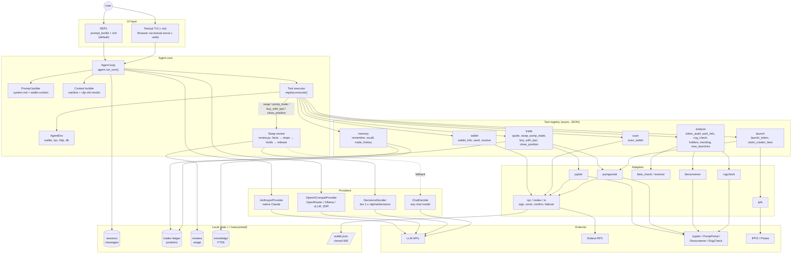
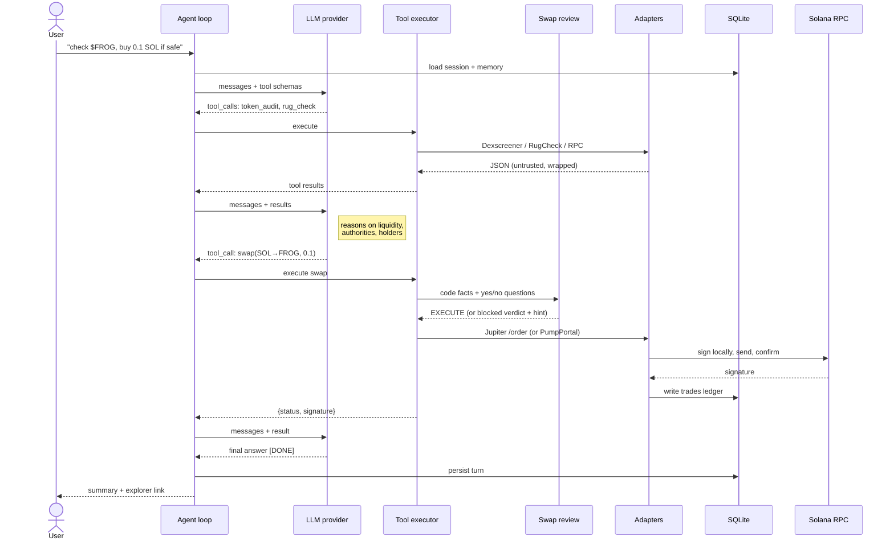

# heavymetalagent: Architecture

## Problem
Memecoin trading is spread across charts, safety checkers, wallet explorers, social platforms and swap UIs. Rookies miss red flags and get rugged. Existing agent kits have no memory, ledger or research workflow, and general agent frameworks are heavy.

## Solution
One lightweight Python agent: natural language in, research and execution out, from its own wallet.

**In one line:** a single async agent loop (DeepSeek V4 Flash or Claude) sends tool calls through a typed registry to thin Solana adapters. Every swap is first reviewed by a decisions model (TypeSafe Jev 1.13), then signed locally with the agent's own wallet. Sessions, trades and reviews live in SQLite. OpenRouter traffic is Zero Data Retention by default.

## Component view

The loop runs LLM → tool_calls → [review] → execute → results → LLM … until `[DONE]` or `llm.max_iterations`. Ctrl+C interrupts the turn without quitting.

## Tool-call sequence

## Why not existing agents
- General frameworks (e.g. Hermes Agent): heavy, no wallet model or tx pipeline.
- Chain toolkits (Solana Agent Kit, agentipy, Coinbase AgentKit): action libraries without memory, ledger or research loop.
- Telegram trading bots: closed source, ~1% fee per trade, no reasoning.

## Why Solana (vs Ethereum L1)
- **Speed:** ~0.4 s slots vs ~12 s blocks, and confirmation in seconds vs ~13 min finality.
- **Fees:** a 5,000-lamport base fee per signature vs a congestion-priced gas auction.
- **Simpler flow:** no approve step before swaps, and bonding-curve launches take one transaction.

Ethereum L2s narrow the gap, and the core is chain-agnostic, but most memecoin activity is on Solana.

## Layers
1. **UI**: prompt_toolkit/rich REPL (default, `heavymetal`), fullscreen Textual TUI (`heavymetal --tui`), browser mode via textual-serve (`heavymetal --web`). The core is UI-agnostic via `on_delta` / `on_tool` callbacks.
2. **Agent loop**: LLM call, parse tool calls, execute, feed results back; max iterations; Ctrl+C interrupt; context pruning.
3. **Provider layer**: native Anthropic provider (any `claude-*` model) + OpenAI-compatible provider (OpenRouter, Ollama, vLLM), streaming, `provider.zdr=true` + `data_collection=deny` on OpenRouter calls.
4. **Swap review** (`review.py` + `decide.py`): code facts → narrow yes/no questions (`user_requested`, `params_ok`, `manipulation`, `intended_repeat`, `fake_or_copycat`) → code holds → fixed-priority release. Jev 1.x answers all questions in one `/api/alpha/decisions` call with probabilities; any other model answers via chat prompts. Fails closed.
5. **Tool registry**: async functions returning JSON strings, with hand-written schemas.
6. **Adapters**: RPC with multi-node failover, Jupiter, PumpPortal, Dexscreener, RugCheck, IPFS, fake-token/homoglyph checks, link resolver.
7. **Storage**: SQLite (sessions, messages, trades, positions, reviews, usage, knowledge) under `~/.heavymetal/` (override with `HEAVYMETAL_HOME`).

## Transaction pipeline
[review for swaps] → build or fetch tx → sign locally (partial signing for co-signed Jupiter RFQ txs) → send via RPC → re-broadcast until confirmed / failed / blockhash expired → trades ledger.

## Risk model
- **No confirmations:** execution is autonomous.
- **Prompt injection:** untrusted inputs (token metadata, memos, web content) can carry it.
- **Key on disk:** the wallet key is stored locally.
- **Spending limit:** the wallet balance is the only cap, so fund it with small amounts.
- **TP/SL:** targets are tracked but not executed automatically.
